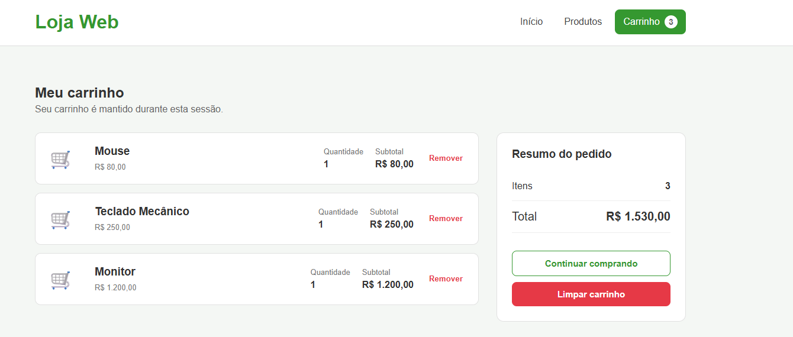

# Testes obrigatórios — Loja Web com HttpSession

1. Acesse `/produtos` e adicione Mouse (id 2), Teclado Mecânico (id 3) e Monitor (id 4).
2. Acesse/atualize `/carrinho`: os itens devem permanecer porque a lista está no atributo de sessão `carrinho`.
3. Vá a `/produtos` e volte a `/carrinho`: os mesmos itens devem permanecer enquanto a sessão estiver ativa.
4. Abra uma janela anônima e acesse `/carrinho`: o carrinho estará vazio, pois a janela anônima usa outra sessão/cookie JSESSIONID.
5. Abra outro navegador e adicione produtos diferentes: os carrinhos serão independentes porque cada navegador possui uma sessão HTTP diferente.
6. Remova um produto pelo botão Remover. O JavaScript envia `DELETE /carrinho/itens?id={id}`.
7. Clique em Limpar carrinho. O JavaScript envia `DELETE /carrinho`; o Servlet executa somente `session.removeAttribute("carrinho")`, preservando os demais dados da sessão.

## Endpoints
- GET `/produtos`
- GET `/carrinho`
- POST `/carrinho/itens`
- DELETE `/carrinho/itens?id={id}`
- DELETE `/carrinho`

## Observação
As JSPs utilizam EL/JSTL e não utilizam Scriptlets Java.
